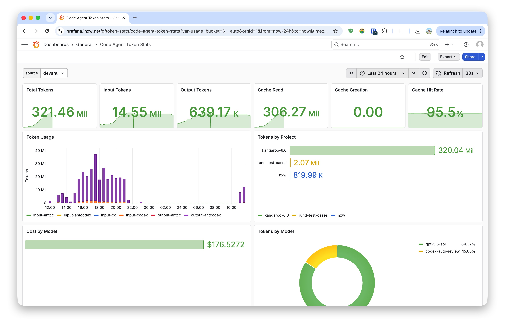

# Token Exporter

A Prometheus exporter that watches Claude Code, AntCC, Codex, and CodeFuse Codex JSONL conversation files and exposes token usage metrics.

## Grafana Dashboard



Import `grafana/dashboards/token-stats.json` or use the included provisioning. The dashboard includes:

- **All Agents** — combined summary stats and per-agent timeseries
- **Per-Agent Groups** — auto-generated sections for each agent (antcc, cc, codex, antcodex) with:
  - Summary stats: total, input, output, cache tokens, cache hit rate
  - Token Usage chart — stacked timeseries of input/output/cache read/cache creation
  - Cache Hit Rate chart — `cache_read / (cache_read + input)` over time
- Filterable by **source**

## Features

- Tracks input, output, cache creation, and cache read tokens per agent and model
- Tracks cost in USD
- Supports multiple agents: Claude Code, AntCC (CodeFuse), Codex, CodeFuse Codex
- Configurable source label for multi-machine setups
- Persists watcher state to avoid double-counting JSONL history after restarts
- Grafana dashboard included

## Quick Start

```bash
# Build and push
make
make push

# Run locally
docker run -d \
  --name token-exporter \
  --net host \
  -v ~/.claude:/root/.claude:ro \
  -v ~/.codefuse:/root/.codefuse:ro \
  -v ~/.codex:/root/.codex:ro \
  -v ~/.token-exporter:/root/.token-exporter \
  -e SOURCE=devhome \
  xavierniu/token-exporter:latest
```

## Configuration

| Env Var | Default | Description |
|---|---|---|
| `LISTEN_PORT` | `14531` | Prometheus metrics port |
| `WATCH_INTERVAL` | `60` | Seconds between checks for changed session files (how fresh the exposed metrics are). A root with no changed files costs only a `stat` per file; `ccusage` and the JSONL parsers run only for roots that changed, and once a day when the scan window moves |
| `PERSIST_INTERVAL` | `600` | Seconds between state-file flushes; a crash re-emits at most this much usage on restart (idempotent, no double count) |
| `CLAUDE_CONFIG_DIR` | `~/.claude,~/.codefuse/engine/cc` | Comma-separated Claude Code/AntCC config directories using `projects/` subdirs |
| `CODEX_CONFIG_DIR` | `~/.codex,~/.codefuse/engine/codex` | Comma-separated Codex/CodeFuse Codex config directories using `sessions/` subdirs |
| `DAYS_BACK` | `7` | Days of history to scan on startup |
| `SOURCE` | `""` | Source label for multi-machine setups |
| `STATE_FILE` | `~/.token-exporter/state.json` (`/root/.token-exporter/state.json` in Docker, since the container runs as root) | JSON state file for processed offsets, dedup keys, and Codex cumulative counters. Mount this directory to a host volume or counters/dedup state are lost on container recreation. |
| `PRICING_FILE` | `/opt/token-exporter/pricing.json` | Optional local pricing override, keyed by model |
| `PRICING_CACHE` | `~/.token-exporter/pricing-cache.json` | Cached pricing map; official-source caches use sibling files such as `pricing-cache-zai.json` |
| `PRICING_TTL_SECS` | `3600` | Seconds before refreshing the LiteLLM pricing cache |

## Pricing

Claude Code (`cc`) records are read through `ccusage claude daily`, so their
costs come from ccusage's offline pricing snapshot. AntCC, Codex, and CodeFuse
Codex are parsed directly by this exporter, so their costs come from the
shared pricing map plus any `PRICING_FILE` overrides. The shared map is built
from LiteLLM plus official provider sources where available. GLM text model
prices are fetched from Z.ai's official pricing page and cached in a sibling
cache file, with bundled Z.ai rates only as a last-resort fallback when the
official page is unavailable.

Model lookup tolerates providerless names and common case/punctuation
differences, for example `glm5`, `GLM-5`, `glm-5.1`, `glm-5p1`, and
provider-prefixed keys. For official model families, bare names prefer local
or official provider entries such as `zai/` for GLM, `minimax/` for MiniMax,
and `moonshot/` for Kimi, rather than third-party-hosted copies.

## Metrics

Projects use the working directory's basename for every agent. Claude Code
and AntCC read the original path from `sessions-index.json` (`originalPath`)
or the parent session's JSONL `cwd`; Codex uses its session metadata. Thus
`/home/byte/developer/vefaas-sandbox-infra`, `/scratch/vefaas-sandbox-infra`,
and deeper paths all report `vefaas-sandbox-infra`, preserving literal
hyphens, dots, and underscores. Different checkouts with the same basename
are intentionally combined. Claude directories without readable cwd metadata
are skipped and retried, rather than guessing from the lossy encoded key.

Existing installations must migrate persisted project labels once before
starting this version; fresh installations need no migration. The standalone
[`migrate_project_names.py`](migrate_project_names.py) script handles the
collector cursors, cumulative counters, daily totals, and costs together.
It is not invoked by the application, `install.sh`, or `remove.sh`.

Build/publish the updated image before the maintenance window. From this
checkout on the exporter host, preview with all monitored Claude/AntCC config
directories (repeat `--claude-dir` for each user):

```bash
sudo docker run --rm --volumes-from token-exporter:ro \
  --mount "type=bind,src=$PWD,dst=/migration,readonly" --workdir /migration \
  --entrypoint python xavierniu/token-exporter:latest \
  migrate_project_names.py --state-file /root/.token-exporter/state.json \
  --claude-dir /home/byte/.claude \
  --claude-dir /home/byte/.codefuse/engine/cc
```

After reviewing the preview, stop the exporter and apply using the same
paths. Use the configured `STATE_FILE` if it differs from the example:

```bash
sudo docker stop token-exporter
sudo docker run --rm --volumes-from token-exporter \
  --mount "type=bind,src=$PWD,dst=/migration,readonly" --workdir /migration \
  --entrypoint python xavierniu/token-exporter:latest \
  migrate_project_names.py --state-file /root/.token-exporter/state.json \
  --claude-dir /home/byte/.claude \
  --claude-dir /home/byte/.codefuse/engine/cc --apply
```

Then recreate the exporter with the updated image and its existing mounts
and environment. Do not restart the old image with migrated state. Verify
the `/metrics` project labels and unchanged totals before resuming normal
operation. The script keeps exact originals and a mapping manifest in a
timestamped `project-names-backup-*` directory beside the state files. To
roll back, stop the exporter and restore **all** files from that backup before
starting the old image. Keep backups until verification is complete.

Rerunning the script is a no-op for migrated state. Missing or ambiguous
metadata aborts before changes; supply explicit aliases with `--project-map`,
for example `{"cc":{"old-project-label":"my-project"}}`, for removed logs
or confirmed legacy collisions. After all hosts have migrated, remove the
one-shot script and `tests/test_project_migration.py`.

This migration changes exporter state, not historical samples already stored
in Prometheus. Renaming cumulative series creates a new label set; queries
spanning the transition must account for the old series and the restored
baseline to avoid counting history twice. Keep historical dashboard handling
separate from the collector's basename rule.

| Metric | Type | Labels |
|---|---|---|
| `codeagent_input_tokens_total` | Counter | source, agent, project, model |
| `codeagent_output_tokens_total` | Counter | source, agent, project, model |
| `codeagent_cache_creation_tokens_total` | Counter | source, agent, project, model |
| `codeagent_cache_read_tokens_total` | Counter | source, agent, project, model |
| `codeagent_cost_usd_total` | Counter | source, agent, project, model |

## Docker Compose

```bash
docker compose up -d
```

This starts the exporter, Prometheus, and Grafana together.
